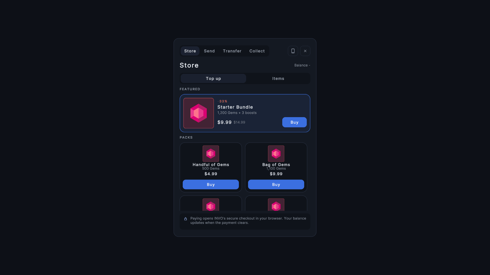
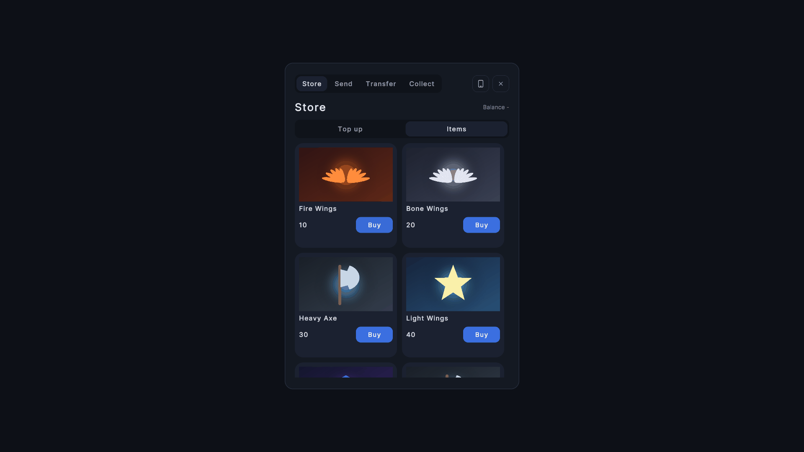
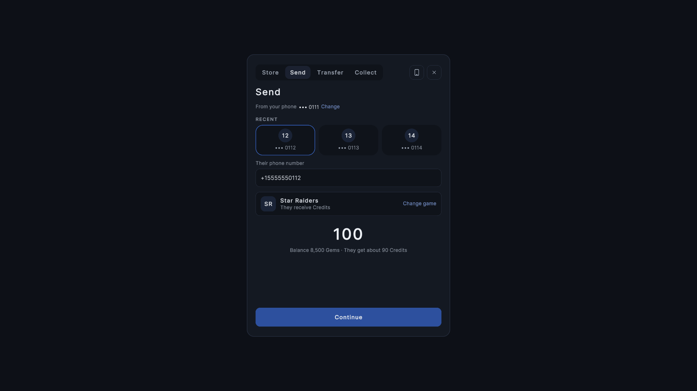
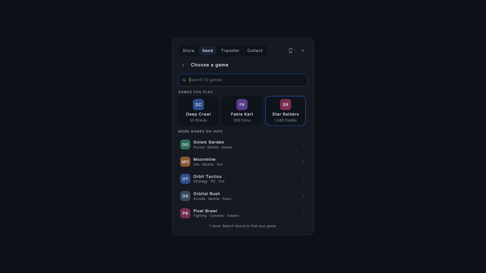
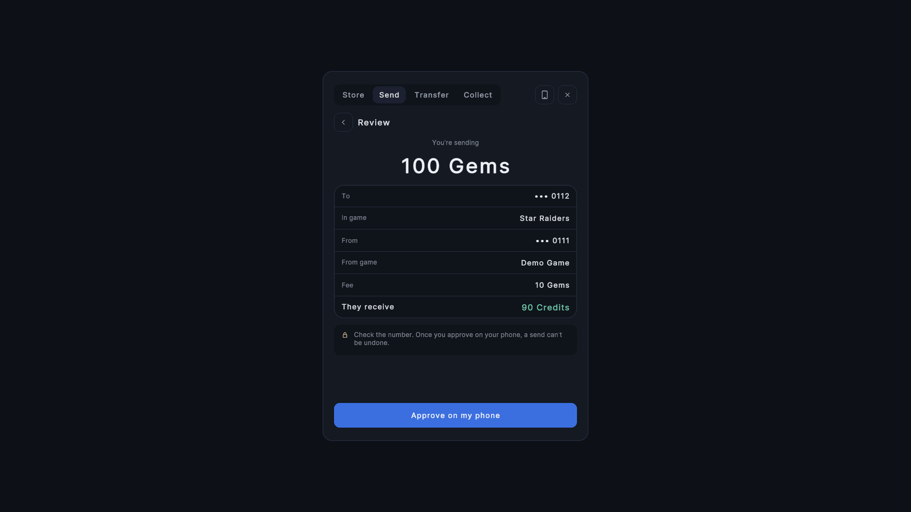
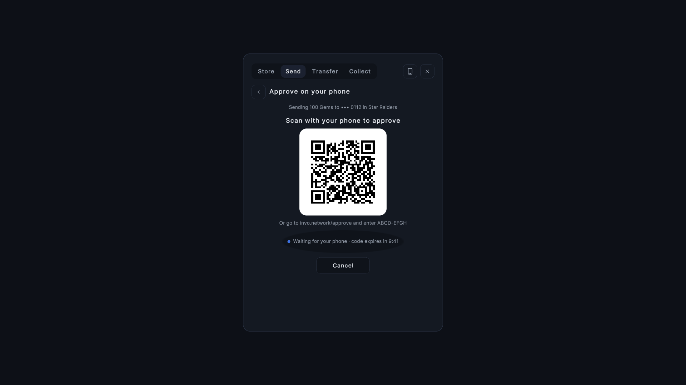
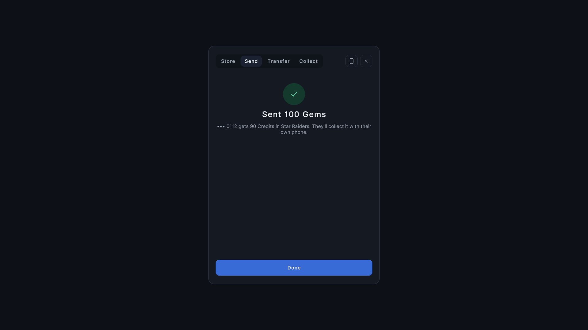
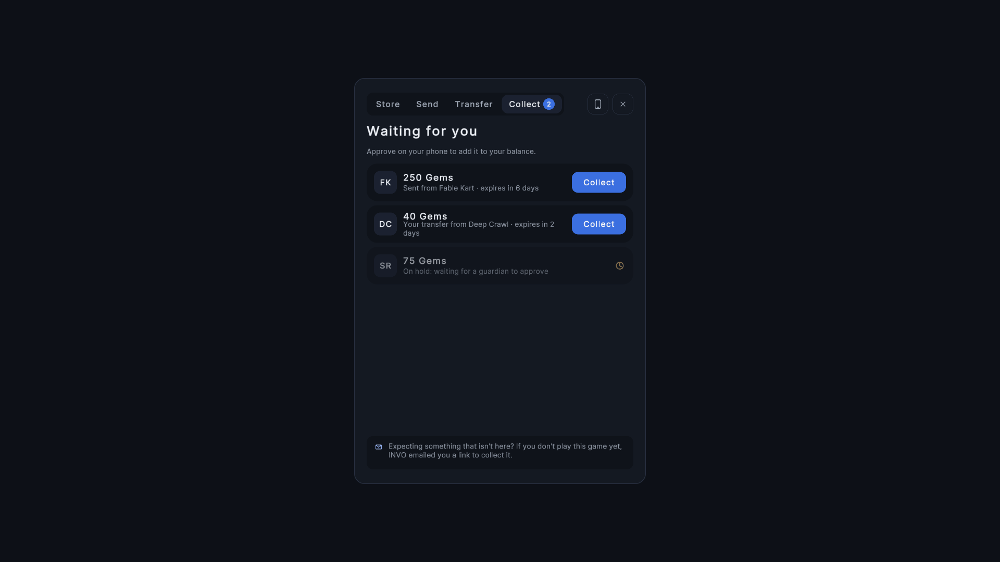
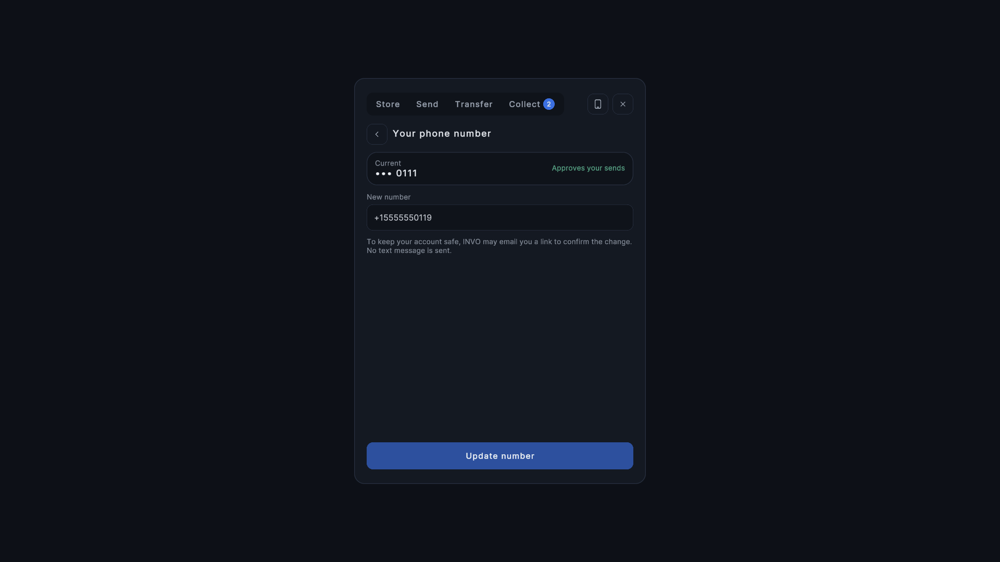
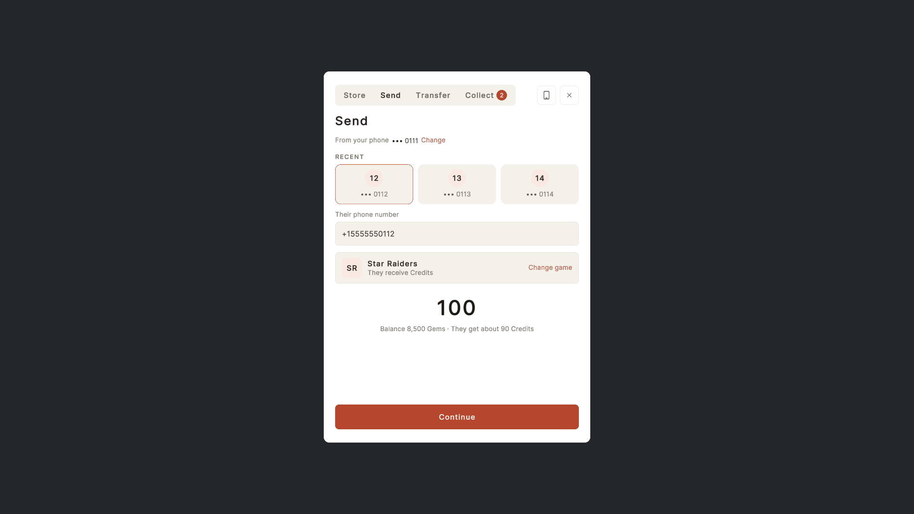

<p align="center">
  
</p>

<h1 align="center">Invo SDK for Unity</h1>

<p align="center">
  <strong>In-game currency for Unity: balances, item purchases, and sends and transfers approved on the player's phone.</strong>
</p>

<p align="center">
  <a href="https://docs.invo.network/docs/unity-sdk"></a>
  <a href="#requirements"></a>
  <a href="#requirements"></a>
  <a href="#requirements"></a>
  <a href="#license"></a>
  <a href="https://github.com/Invo-Technologies/Invo-unity-sdk/releases"></a>
</p>

<p align="center">
  <a href="#quick-start">Quick start</a> •
  <a href="#installation">Installation</a> •
  <a href="#configuration">Configuration</a> •
  <a href="#theming-and-customising-the-ui">Theming</a> •
  <a href="#security">Security</a> •
  <a href="#server-side-proxy">Server-side proxy</a> •
  <a href="#api-reference">API reference</a> •
  <a href="#troubleshooting">Troubleshooting</a>
</p>

---

The Invo SDK connects a Unity game to the [Invo Network](https://invo.network). It gives you:

- **Player balances**, with a polling loop and a bindable label.
- **Item purchases** paid from the player's in-game balance.
- **Sends** from one player to another, addressed by phone number.
- **Transfers** of a player's own balance to another game on the network.
- **Phone approval** for every send, transfer and collect: a QR code on desktop and console, INVO's page in the system browser on iOS and Android. No SMS codes.
- **Hosted checkout** for real-money currency packs, through an endpoint you host.
- **Drop-in uGUI panels** for all of the above, restyled from one theme asset.

It is a client. A production launch also needs a small server of your own that holds your INVO keys. See [Security](#security) and [Server-side proxy](#server-side-proxy) before you plan the work.

## What's new in 3.1

- **UPM package.** Install from a git URL or a `.unitypackage`. The SDK lives in `Packages/com.invonetwork.unity-sdk`; nothing is copied into `Assets/`.
- **Unity 2021.3 LTS and newer.** Tested on 2021.3, 2022.3 and Unity 6. 3.0 required Unity 6.
- **New UI.** New prefabs for Store (Top up and Items), Send, Transfer, Collect and Phone, a live balance label, a game picker with search, recent recipients, and a single `InvoTheme` asset that restyles every panel without editing prefabs.
- **Settings window** (`InvoSDK > Settings`) with separate Sandbox and Production tabs, one sandbox key per storefront, and Test connection buttons.
- **Storefronts.** The SDK knows which store a build is for (Steam, Google Play, App Store, PlayStation, Xbox, Nintendo Switch, Epic, Web, Platform) and tells your game server through the `X-Invo-Storefront` header.
- **Build guard.** A production build fails without a production Game ID and an https Game Server URL, and never contains a sandbox key or the test player.
- **Phone change.** Players can change their phone number. Secured accounts confirm through a link INVO emails them.
- **Collect panel.** Lists everything waiting for the player, each with its own Collect button. No claim-code form.
- **Fixes from 3.0.** Requests and polling delays now work on 2021.3 and 2022.3 (and on WebGL). The Inter font asset rendered no text on 2021.3/2022.3. `InvoDeviceApprovalPanelView` could not be saved in a scene or prefab.

The public API from 3.0 is unchanged: `APIManager` methods, `InvoSDKConfig` fields, namespaces and component names all still work. See [Upgrading from 3.0](#upgrading-from-30).

## Screenshots

Unity 6000.0, default dark theme unless noted.

<table>
  <tr>
    <td align="center"><br/><sub>Store: top up (real money)</sub></td>
    <td align="center"><br/><sub>Store: items (in-game balance)</sub></td>
    <td align="center"><br/><sub>Send: recipient and amount</sub></td>
  </tr>
  <tr>
    <td align="center"><br/><sub>Send: choose a game</sub></td>
    <td align="center"><br/><sub>Send: review</sub></td>
    <td align="center"><br/><sub>Send: approve on your phone</sub></td>
  </tr>
  <tr>
    <td align="center"><br/><sub>Send: sent</sub></td>
    <td align="center"><br/><sub>Collect</sub></td>
    <td align="center"><br/><sub>Change phone number</sub></td>
  </tr>
  <tr>
    <td align="center"><br/><sub>Example light theme</sub></td>
    <td></td>
    <td></td>
  </tr>
</table>

The same screens on 2021.3 and 2022.3 are in `Docs/screenshots/2021.3/` and `Docs/screenshots/2022.3/`, with side-by-side comparisons in `Docs/screenshots/compare/`. An interactive design preview of the new UI also exists.

---

## Contents

- [Quick start](#quick-start)
- [Requirements](#requirements)
- [Installation](#installation)
- [Upgrading from 3.0](#upgrading-from-30)
- [Configuration](#configuration)
- [The UI](#the-ui)
- [Theming and customising the UI](#theming-and-customising-the-ui)
- [Security](#security)
- [Server-side proxy](#server-side-proxy)
- [Authentication](#authentication)
- [API reference](#api-reference)
- [Phone approval](#phone-approval)
- [Error handling](#error-handling)
- [Not every 2xx is a success](#not-every-2xx-is-a-success)
- [Phone numbers](#phone-numbers)
- [Money and locales](#money-and-locales)
- [Idempotency](#idempotency)
- [Endpoints](#endpoints)
- [Hosted checkout (real-money purchases)](#hosted-checkout-real-money-purchases)
- [Hosted approval on mobile (system browser)](#hosted-approval-on-mobile-system-browser)
- [What the SDK does not do](#what-the-sdk-does-not-do)
- [Editor tools](#editor-tools)
- [Troubleshooting](#troubleshooting)
- [Examples](#examples)
- [Support](#support)
- [License](#license)

---

## Quick start

**1. Get sandbox credentials.** Sign in to the [sandbox console](https://dev.console.invo.network), create a game, and copy its **Game ID** and a **sandbox SDK key** for each storefront you sell on.

**2. Install the package.** In **Window > Package Manager**, choose **+ > Add package from git URL** and enter:

```
https://github.com/Invo-Technologies/Invo-unity-sdk.git?path=/Packages/com.invonetwork.unity-sdk#v3.1.0
```

On Unity 2021.3 or 2022.3, accept the dialog that offers to add TextMeshPro if it appears.

**3. Configure.** Open **InvoSDK > Settings**. On the **Sandbox** tab, enter the sandbox Game ID and paste each storefront's sandbox key. Click **Test connection**. Add a test player (email, phone in `+` international format, name).

**4. Add the prefabs.** Drag these into your first scene:

| What | Where |
|---|---|
| `InvoAPI.prefab` | `Packages/Invo SDK/Runtime/Prefabs/` (the `APIManager` singleton) |
| `InvoSDKWindow.prefab` | `Packages/Invo SDK/Runtime/Prefabs/` (the canvas with every panel) |
| An EventSystem | **GameObject > UI > Event System**. See [Input](#input-eventsystem). |

Or import the **Demo** sample (**Package Manager > Invo SDK > Samples > Demo**), which has all three.

**5. Open the window from your own UI.**

```csharp
using InvoSDK.UI.Core;

// From your "Wallet" or "Store" button. Panel ids: Store, Sender, Transfer, Collect, Phone.
InvoSDKWindowController.Instance.Open("Store");
InvoSDKWindowController.Instance.Close();
InvoSDKWindowController.Instance.Toggle();
```

The window opens on start by default. Untick **Open On Start** on its `InvoSDKWindowController` to keep it closed until you open it.

**6. Tell the SDK who is playing.** In a real game, call this from your own login, before the player opens the window:

```csharp
APIManager.Instance.SetActivePlayer(email, displayName, phoneE164);
```

The test player from the Settings window is only a sandbox convenience.

> **Before production:** you need a [server-side proxy](#server-side-proxy). Production builds hold no INVO keys, and the build fails until a Game Server URL is set.

---

## Requirements

| Requirement | Version / notes |
|---|---|
| Unity | **2021.3 LTS or newer.** Tested on 2021.3.45f2, 2022.3.62f3 and 6000.0.58f2: the package compiles with zero errors and warnings and every EditMode test passes on each. |
| Newtonsoft Json | `com.unity.nuget.newtonsoft-json` 3.2.1. Added automatically. |
| uGUI | `com.unity.ugui`. Added automatically. |
| TextMeshPro | Part of `com.unity.ugui` on Unity 2023.2 and newer. On 2021.3 and 2022.3 it is the separate `com.unity.textmeshpro` package. See [TextMeshPro](#textmeshpro-on-20213-and-20223). |
| Input | Either input backend. The prefabs contain no EventSystem. See [Input](#input-eventsystem). |

The package also depends on the built-in modules `unitywebrequest`, `unitywebrequesttexture`, `androidjni`, `ui` and `imgui`.

| Build target | Phone approval shows | Default storefront |
|---|---|---|
| Windows, macOS, Linux | QR on the game screen | Steam |
| iOS | INVO's page in the system browser | App Store |
| Android | INVO's page in the system browser | Google Play |
| WebGL | QR on the game screen | Web |
| PlayStation, Xbox, Nintendo Switch | QR on the game screen | PlayStation, Xbox, Nintendo Switch |

The tests above are editor tests. Console targets are handled in code (storefront mapping, QR approval) but are not part of the test matrix.

---

## Installation

### From a git URL (recommended)

**Window > Package Manager > + > Add package from git URL**:

```
https://github.com/Invo-Technologies/Invo-unity-sdk.git?path=/Packages/com.invonetwork.unity-sdk#v3.1.0
```

Or add it to `Packages/manifest.json`:

```json
"com.invonetwork.unity-sdk": "https://github.com/Invo-Technologies/Invo-unity-sdk.git?path=/Packages/com.invonetwork.unity-sdk#v3.1.0"
```

The `#v3.1.0` suffix pins the release. Change it to upgrade.

### From a .unitypackage

Download `InvoSDK-3.1.0.unitypackage` from the [GitHub release](https://github.com/Invo-Technologies/Invo-unity-sdk/releases) and import it. It contains the same package; Unity places it under `Packages/` as an embedded package.

### What is in the package

| Folder / assembly | Contents |
|---|---|
| `Runtime/` (`InvoSDK.Runtime`) | `APIManager`, models, phone approval, QR encoder, UI components, themes, prefabs |
| `Editor/` (`InvoSDK.Editor`) | Settings window, build guard, mobile return-scheme postprocessor, test windows |
| `Editor/Setup/` (`InvoSDK.Editor.Setup`) | The TextMeshPro check. It has no references, so it compiles even when TextMeshPro is missing. |
| `Tests/Editor/` (`InvoSDK.Tests.Editor`) | EditMode tests |
| `Samples~/Demo` | Demo scene, sample item catalog and window config, and `InvoCaptureDriver` |

`InvoCaptureDriver` does nothing unless the player starts with `-invoCapture <folder>`. It then steps through every SDK screen with test data (no money moves, no approval starts), saves PNGs and quits. It produced the screenshots above.

### TextMeshPro on 2021.3 and 2022.3

On these versions TextMeshPro is a separate package, and a UPM dependency cannot depend on the editor version. New projects from the Unity Hub 3D templates already include it. If yours does not, the SDK shows a dialog on first load: **Add TextMeshPro** adds `com.unity.textmeshpro` for you. Then import **Window > TextMeshPro > Import TMP Essential Resources** if Unity asks. In batch mode the SDK logs an error instead of showing the dialog.

### Input (EventSystem)

The prefabs contain no EventSystem, so they work with either input backend. Your scene needs exactly one, with the module that matches **Project Settings > Player > Active Input Handling**:

| Active Input Handling | EventSystem module |
|---|---|
| Input Manager (Old) | `StandaloneInputModule` |
| Input System Package (New) | `InputSystemUIInputModule` |
| Both | Either |

The Demo sample uses `StandaloneInputModule`. With "Input System Package (New)" only, select the EventSystem and click **Replace with InputSystemUIInputModule**.

---

## Upgrading from 3.0

3.0 was copied into `Assets/`. 3.1 is a package. Every file kept its GUID, so scenes and prefabs that reference SDK scripts, sprites or prefabs keep working.

1. Back up your project. **Keep `Assets/InvoSDK/Resources`**: it holds your config, item catalog and window config.
2. Delete the rest of the old SDK: `Assets/APIManager.cs`, `Assets/InvoSDK/Scripts`, `Assets/InvoSDK/Tests`, `Assets/InvoSDK/Prefabs`, `Assets/InvoSDK/Inter`, `Assets/InvoSDK/NewArt`, `Assets/InvoSDK/Sprites` and `Assets/Plugins/iOS/InvoHostedApproval.mm`.
3. Install the package as above.
4. Open **InvoSDK > Settings**. If your config came from 3.0, the Sandbox tab shows **Move the 3.0 key and Game ID into Sandbox**. Click it. Until you do, the 3.0 `sdkKey` and `gameId` are still honoured.
5. Enter your **production** Game ID on the Production tab. Sandbox and production are separate INVO titles with separate IDs.

If you built your own layouts around the 3.0 `SenderCurrencyPanel` and `TransferCurrencyPanel`, the wiring checklist in [InvoSDK-README.md > Updating your UI for 3.0.0](InvoSDK-README.md#updating-your-ui-for-300) still applies to them. The new 3.1 prefabs are already wired.

---

## Configuration

All settings live in one asset, `Assets/InvoSDK/Resources/InvoSDKConfig.asset`, edited in **InvoSDK > Settings** (also **InvoSDK > Setup Wizard**). The window creates the asset if it is missing. It is **gitignored**: each developer configures their own, and it will not arrive with a clone.

The toolbar at the top of the window chooses what **Play Mode and builds use**: Sandbox or Production. That sets `useProduction`.

### Sandbox and production are separate

Sandbox and production are **separate INVO environments**: separate databases, separate Game IDs and separate SDK keys. A sandbox key does not work against production, and a production key does not work against sandbox.

| | Sandbox | Production |
|---|---|---|
| API base | `https://sandbox.invo.network/sandbox/api` | `https://invo.network/api` |
| Console | [dev.console.invo.network](https://dev.console.invo.network) | [console.invo.network](https://console.invo.network) |
| Payments | Test cards only | Real money |
| Keys in the Unity build | Allowed (sandbox keys only) | **Never** |

The API bases are compile-time constants (`APIManager.SandboxApiBase`, `APIManager.ProductionApiBase`), not Inspector fields. A mistyped host would send your key somewhere that is not Invo.

### Sandbox tab

| Setting | Field | Notes |
|---|---|---|
| Sandbox Game ID | `sandboxGameId` | From the sandbox console. **Test connection** checks it. |
| Sandbox keys | `sandboxKeys` | One `ivsdk_` key per storefront. Steam, Google Play, App Store, PlayStation, Xbox and Nintendo Switch are listed by default; **+ Add storefront** adds Epic Games Store, Web or Platform. Each row has a **Test** button and a format check. |
| Storefront per build target | `storefrontMap` | Which storefront each kind of build belongs to. See [Storefronts](#storefronts). |
| Test player | `playerEmail`, `playerPhone`, `playerName` | The initial active player, for sandbox testing. Stripped from production builds. |
| SANDBOX watermark | `showSandboxWatermark` | A small "SANDBOX · Steam" label in the editor and development builds while the SDK talks to sandbox. Never in release builds. |

Sandbox keys may ship in sandbox and development builds. They are still extractable from the build, so treat them as public.

### Production tab

The Production tab holds **no keys, by design**. INVO's guidance is that an SDK key must never ship in a Unity build. Your game server holds one production key per storefront and attaches it.

| Setting | Field | Notes |
|---|---|---|
| Production Game ID | `productionGameId` | From the production console. Required for a production build. |
| Game Server URL | `gameServerUrl` | Base URL of **your** server, for example `https://api.yourgame.com`. Required for a production build, and must be https. **Test connection** calls it with the `X-Invo-Storefront` header. See [Server-side proxy](#server-side-proxy). |
| Checkout session endpoint | `checkoutSessionEndpoint` | https URL on your server that mints hosted-checkout sessions. See [Hosted checkout](#hosted-checkout-real-money-purchases). |

The tab also shows the production build check live, and links to the console to manage and rotate production keys.

> **`gameServerUrl` applies in both environments.** When it is set, every call that needs a key goes to your server, in sandbox too. Your server then forwards sandbox traffic to the sandbox API. Leave it blank to call INVO directly with the sandbox key while you develop.

### Game & display tab

`gameName`, `gameIconUrl`, `gameCurrencyName`, `gameCurrencyUrl`, `gameVersion`. Shown in the panels. A successful sandbox Test connection fills in the game icon if it is empty.

### Storefronts

INVO issues one SDK key per storefront, per environment. The SDK picks the storefront for each build:

1. A scripting define `INVO_STOREFRONT_<NAME>`, if present, wins.
2. Otherwise the build target's row in the storefront map.
3. Otherwise the default for the build target (see [Requirements](#requirements)).

| Storefront | Scripting define | `X-Invo-Storefront` value |
|---|---|---|
| Steam | `INVO_STOREFRONT_STEAM` | `steam` |
| Google Play | `INVO_STOREFRONT_GOOGLEPLAY` | `google_play` |
| App Store | `INVO_STOREFRONT_APPSTORE` | `app_store` |
| PlayStation | `INVO_STOREFRONT_PLAYSTATION` | `playstation` |
| Xbox | `INVO_STOREFRONT_XBOX` | `xbox` |
| Nintendo Switch | `INVO_STOREFRONT_NINTENDOSWITCH` | `nintendo_switch` |
| Epic Games Store | `INVO_STOREFRONT_EPICGAMESSTORE` | `epic_games_store` |
| Web | `INVO_STOREFRONT_WEB` | `web` |
| Platform | `INVO_STOREFRONT_PLATFORM` | `platform` |

Example: you sell the Windows build on Steam and Epic. Leave Desktop mapped to Steam and add `INVO_STOREFRONT_EPICGAMESSTORE` to the Epic build's scripting defines.

In sandbox the SDK sends that storefront's sandbox key. In production it sends the storefront name to your server in `X-Invo-Storefront`, and your server attaches that storefront's production key. From code: `InvoSDKConfig.ActiveStorefront`, `ActiveSandboxKey`, `ActiveGameId`, `APIManager.Instance.Storefront`, and `InvoStorefrontResolver.WireName(...)`.

### Build guard

`InvoBuildGuard` runs before and after every build. When `useProduction` is on:

- **The build fails** if the production Game ID is empty, if the Game Server URL is empty or not https, or if the checkout session endpoint is set but not https. The error lists each problem.
- **Sandbox keys and the test player are stripped** from the config before the build and restored after it. The values are backed up under `Library/InvoSDK/` first, so an editor crash mid-build cannot lose them; the next editor start restores them.

Sandbox builds are not changed.

### One config asset, not two

The SDK loads `Resources/InvoSDKConfig`. If a second asset with that name exists under another `Resources` folder (`Assets/Resources/InvoSDKConfig.asset` is the usual stray), `Resources.Load` may pick either, and you can build against the wrong key. The Settings window detects the stray and offers to select it. Delete it.

### Config fields kept from 3.0

| Field | 3.1 behaviour |
|---|---|
| `sdkKey` | Used as the sandbox key when the storefront has no key of its own. Never used in production. |
| `gameId` | Used when `sandboxGameId` / `productionGameId` is empty. Also accepted by the build guard as a production Game ID. Set `productionGameId` explicitly. |
| `useProduction` | Set from the Settings toolbar. `APIManager` copies it in `Awake()`. |
| `gameServerUrl`, `checkoutSessionEndpoint` | Unchanged. Now on the Production tab. |
| `playerEmail`, `playerName`, `playerPhone` | Unchanged. The test player. |

---

## The UI

### Prefabs

All under `Runtime/Prefabs/`:

| Prefab | What it is |
|---|---|
| `InvoAPI` | `APIManager`, the singleton every panel talks to. One per game, `DontDestroyOnLoad`. |
| `InvoSDKWindow` | Screen-space canvas: tabs (Store, Send, Transfer, Collect), a phone button, close, the match-code prompt and the SANDBOX watermark. Contains every panel below. |
| `Panels/StorePanel` | Two pages: **Top up** (real-money currency packs) and **Items** (spend the in-game balance). See [Store](#store). |
| `Panels/SendPanel` | Send to another player, with phone approval. |
| `Panels/TransferPanel` | Move the player's own balance to another game, with phone approval. |
| `Panels/CollectPanel` | Everything waiting for the player to collect. |
| `Panels/PhonePanel` | Show and change the player's phone number. |
| `Components/InvoPackHeroCard` | The featured bundle card at the top of Top up. |
| `Components/InvoPackCard` | One currency pack in the Top up grid. |
| `Components/InvoDealCard` | One daily deal. |
| `Components/InvoItemCard` | One item on the Items page. |

Panel ids for `InvoSDKWindowController.Open(...)`: `Store`, `Sender`, `Transfer`, `Collect`, `Phone`. Inside the Store, the page ids are `TopUp` and `Items`.

The 3.0 prefabs (`FeaturedPanel`, `DailyGameItem`, `WeeklyGameItem`, `WeeklyPack`, `FeaturedWeeklyItems`) are still in the package for existing scenes.

### What each flow does

<a id="store"></a>**Store.** Two pages, with a live balance in the header.

| Page | What it does | Components |
|---|---|---|
| **Top up** | Real-money currency packs: a featured bundle hero card, a two-column pack grid and daily deals. **Buy** opens INVO hosted checkout through **your** `checkoutSessionEndpoint`. The SDK POSTs `{player_email, usd_amount}` and expects `{checkout_url}`; your server calls `POST /api/checkout/sessions` with the game secret. The key never reaches the client. See [Hosted checkout](#hosted-checkout-real-money-purchases). | `InvoSDKFeaturedPanel` |
| **Items** | Spend the in-game balance on items from your local `InvoSDKItemCatalog`, with a confirmation step. Calls `PurchaseItemAsync`. | `ItemPurchasePanel`, `ItemPurchaseConfirmPanel` |

The header balance is an `InvoBalanceLabel`. It shows `APIManager.Instance.LastBalance` and updates on every `APIManager.BalanceChanged` event (raised after each balance poll, with the spendable balance). Put one anywhere in your own UI the same way.

**Send.**
1. The player's own phone is shown masked (`••• 0111`) with a **Change** link. There is no sender phone field.
2. A **recent recipients** row offers the last five numbers this player sent to.
3. The **game picker** has search pinned at the top, "Games you play" tiles from `POST /api/players/destinations`, every other game as a list, unavailable games greyed with a reason, and a no-results state.
4. **Review** shows INVO's fees and says the send can't be undone once approved.
5. **Approve** shows the QR (or opens INVO's page on mobile), the match-code prompt for a first-time phone, and hold screens for guardian or review holds.
6. **Sent** confirms it.

Recent recipients are stored **on the device only** (`InvoRecentRecipientsStore`, `PlayerPrefs`, at most five per player). The key is a hash of the player's email, so emails are not written to disk. INVO's API does not return recipients' numbers, which is why the list is local. Call `InvoRecentRecipientsStore.Clear(email)` on sign-out if players share a device.

**Transfer.** The same steps, for the player's own balance between games. Both phones default to the player's phone.

**Collect.** `InvoCollectPanel` lists the `receiving_confirm` items from `GET /api/sdk/transfers/pending`, each with its own **Collect** button that runs the receiver's phone approval. Held items are greyed with the reason. It refreshes while open and can show a count on the Collect tab. There is **no claim-code form**: INVO is retiring claim codes, and a receiver with no account in the game collects through the link INVO emails them.

**Phone.** `InvoPhoneSettingsPanel` shows the current phone masked and changes it:
- An unsecured account switches at once.
- A secured account gets `409 PHONE_CHANGE_REQUIRES_VERIFICATION`. The panel then creates a change request, INVO **emails** the player a link, and they confirm on INVO's page. No SMS is sent. The panel polls the request and switches when it is confirmed.

Save the new number in your own account system too: subscribe to `APIManager.PlayerPhoneChanged`.

### Window manager

```csharp
public class InvoSDKWindowManager : MonoBehaviour   // InvoSDK.UI.Core
{
    public List<PanelEntry> panels;                 // { string panelId; GameObject panel; }
    public string CurrentPanelId { get; }
    public event Action<string> PanelShown;
    public void ShowPanel(string id);
    public void HideAll();
}
```

Small components that sit around it:

| Component | What it does |
|---|---|
| `InvoSDKWindowController` | `Open(panelId)`, `OpenDefault()`, `Close()`, `Toggle()`, `IsOpen`, static `Instance`. Wraps the window manager. |
| `InvoTabBar` | Highlights the tab of whichever panel is showing, including panels opened from code. |
| `InvoDefaultPage` | Shows its `pageId` on the window manager on the same object the first time it is enabled (the Store uses it to open on Top up). |
| `InvoHideWhenEmpty` | Fades its object out while a text is empty, for status pills and badges. Needs a `CanvasGroup`. |
| `InvoBalanceLabel` | Live spendable balance, from `APIManager.BalanceChanged`. Its `format` takes `{0}` balance and `{1}` currency name. |

### Fees, images and quantity

- **Fees.** Panels show a local estimate before initiate, then replace it with `fees_preview` from the response. Always display the returned figures: per-tenant rates mean a local calculation can be wrong. Sends and transfers use different key names for the fee legs (`sending_game_fee` / `receiving_game_fee` / `platform_fee` versus `source_game_fee` / `target_game_fee` / `invo_fee`); `total_fee` and `net_amount` are common to both.
- **Images.** Catalog artwork must be https, at most 4 MB and at most 4096 px on a side (`FeaturedItemCard.MaxImageBytes` / `MaxDimension`), or it is skipped with a warning.
- **Quantity.** Purchases are fixed at quantity 1, though the API accepts 1 to 1000. To add a stepper, replace the `PurchaseQuantity` constant in `ItemPurchaseConfirmPanel`; `totalPrice` is already derived from it in `decimal`.

---

## Theming and customising the UI

The panels are built to be restyled without touching the prefabs.

### Themes

| Piece | What it does |
|---|---|
| `InvoTheme` (ScriptableObject) | Every colour role (backdrop, surface, field, border, accent, text, link, success, warning, danger), the font (`TMP_FontAsset`; empty keeps Inter), `textScale`, `cornerRadius`, `smallCornerRadius` and `spacing`. Optional sprite overrides for rounded and circle shapes. |
| `InvoThemeProvider` | On the window root. Its `theme` applies to everything below it. Empty uses the default. |
| `InvoThemed` | On every graphic in the SDK prefabs. Sets the graphic's colour role, shape and text style from the nearest provider's theme. Remove it from an element to opt that element out. |

Two themes ship in `Runtime/Resources/`: `InvoDefaultTheme` (dark, the default) and `InvoLightTheme` (an example light theme).

To make your own:

1. Duplicate `InvoDefaultTheme` (or create one with **Create > InvoSDK > Theme**) into your `Assets/` folder.
2. Change the values.
3. Assign it to **Theme** on the `InvoThemeProvider` on the `InvoSDKWindow` root.

Every panel restyles live, in the editor too. Package updates never overwrite your copy.

To switch themes at runtime (a light/dark toggle, a per-player skin), set the provider's `theme`:

```csharp
using InvoSDK.UI;

GetComponent<InvoThemeProvider>().theme = myLightTheme;   // restyles on the next frame
```

### Going further

| You want to | Do this |
|---|---|
| Change layout or add art to one panel | Make a **prefab variant** of the panel or window and edit the variant. |
| Draw the QR approval in your own UI | Implement `IInvoDeviceApprovalView` (`ShowQr`, `ShowBrowserWaiting`, `ShowStatus`, `Hide`) and pass it to `InvoDeviceApproval.RunAsync`, or use the uGUI `InvoDeviceApprovalPanelView`. |
| Draw the match-code prompt yourself | Implement `IInvoEnrollmentPromptView` and assign `InvoHostedApproval.PromptView`. The window's `InvoEnrollmentPromptPanel` does this for you with uGUI. |
| Build your own panels | Reuse the components (`InvoGamePicker`, `InvoRecentRecipients`, `InvoCollectPanel`, `InvoPhoneSettingsPanel`, `InvoApprovalStep`) or call `APIManager` directly. |

Keep the QR `RawImage` square, with the texture's white border intact, and draw nothing over it. Cropped, tinted or stretched QR codes do not scan.

---

## Security

### A key in a Unity build is public

Unity bundles everything under a `Resources/` folder into the player. `InvoSDKConfig.asset` is under `Assets/InvoSDK/Resources/`, so any key in it is in `resources.assets` in every build. Anyone with a copy of the game can recover it with `strings` in about a minute. No obfuscation changes this: the game has to read the key at runtime.

That is why 3.1 keeps production keys out of the config entirely, and why the build guard strips sandbox keys from production builds.

### What an extracted key can do

An `ivsdk_` key is a **full tenant credential**, not a scoped client token. Someone holding it can:

- charge cards through your checkout, in your name;
- move any player's balance, by initiating sends and transfers for accounts that are not theirs;
- request a bank payout of your developer revenue;
- mint player tokens for any player in your game (`POST /api/sdk/player-token`) and act as them;
- reconfigure your webhooks.

There is no per-scope restriction and no IP allowlist.

### Keys carry no environment marker

Sandbox and production keys look identical. Nothing in the string says which environment it belongs to. Check where a key came from before you paste it, every time.

### Item prices are not checked by Invo

`POST /api/item-purchases/purchase-item` checks only that `total_price == unit_price × quantity`, that both are positive, and that they are under 999999.99. It does not look up the item's price; `item_id` is an opaque string. Called from a game client, a modified build sets its own prices. Your server must set prices from its own catalog.

### If a key leaks, rotate it with `immediate: true`

The default rotation keeps the old key working for a **7-day grace window**, and that grace is not honoured the same way on every endpoint. For a leaked key, take the hard cutover with `immediate: true` and update your server in the same change.

### The position, stated plainly

| | |
|---|---|
| Sandbox key in the config | Allowed. Treat it as public. |
| Production key anywhere in the Unity project | **Never.** The Production tab has no key field for this reason. |
| Production integration | **Requires a [server-side proxy](#server-side-proxy).** |

### Production checklist

In order. Items 1 to 3 come first; nothing after them works without them.

- [ ] **1. Stand up your server.** See [Server-side proxy](#server-side-proxy).
- [ ] **2. Put one production key per storefront on that server.** Pick the key from `X-Invo-Storefront`.
- [ ] **3. Set the Production tab:** production Game ID and an https Game Server URL. Authenticate the player with your own session before proxying anything (`APIManager.GameServerRequestDecorator`).
- [ ] **4. Set prices server-side** from your own catalog. Never trust a client-supplied `unit_price`.
- [ ] **5. Host your checkout-session endpoint**, if you sell real-money packs. See [Hosted checkout](#hosted-checkout-real-money-purchases).
- [ ] **6. Receive and verify webhooks.** HMAC-SHA256 over `"{timestamp}.{raw_body}"` in `X-Invo-Signature`, reject anything outside a 5-minute window, dedupe on `X-Invo-Idempotency-Key`. Webhooks are your source of truth for real-money credit.
- [ ] **7. Handle the non-completion states:** 200 `needs_account_selection`, 202 `pending_guardian_approval`, 202 `pending_confirmation`, 403 `GUARDIAN_REQUIRED`, 409 `PHONE_SHARE_APPROVAL_REQUIRED`.
- [ ] **8. Treat a 409 on purchase as success.** Check this in your own UI.
- [ ] **9. Pass `client_request_id` through your proxy unchanged.**
- [ ] **10. Test the whole flow in sandbox first**, including failures, on a device with a comma-decimal locale.
- [ ] **11. Confirm nothing logs** claim codes, device codes, player tokens or raw response bodies.
- [ ] **12. Switch the Settings toolbar to Production and build.** Then run `strings` on the built player and confirm no `ivsdk_` string remains.

---

## Server-side proxy

> The Settings window's "Read: setting up the server-side proxy" button links here.

The rule behind everything in this section:

> **An INVO SDK key is a server-side credential. A Unity player build cannot hold it safely.**

```
Unity client ──(your session + X-Invo-Storefront)──▶ Your server ──(X-Game-Secret-Key)──▶ Invo API
                                                          ▲
                                                          └──── webhooks (HMAC-signed) ────┘
```

### The contract

Set **Game Server URL** on the Production tab. The SDK then sends every call that needs a key to `<gameServerUrl>/api/<Invo path>`, with Invo's own method and JSON body. Every such request carries:

| Header | Value |
|---|---|
| `X-Invo-Storefront` | The build's storefront: `steam`, `google_play`, `app_store`, `playstation`, `xbox`, `nintendo_switch`, `epic_games_store`, `web` or `platform`. |
| Your session | Whatever `APIManager.GameServerRequestDecorator` adds (cookie, bearer token, signed header). Never the INVO key. |

Your server:

1. authenticates **your** player session;
2. checks the path against the allow-list below, and rejects unknown `X-Invo-Storefront` values;
3. adds `X-Game-Secret-Key` with **that storefront's** key for the environment, and forwards to `https://invo.network/api/<path>` (sandbox: `https://sandbox.invo.network/sandbox/api/<path>`);
4. returns Invo's status code and body **unchanged**. The SDK reads Invo's error envelope and `status` strings.

```csharp
// Attach YOUR session to every game-server request. Never put the INVO key here.
APIManager.GameServerRequestDecorator = req =>
    req.SetRequestHeader("Authorization", "Bearer " + MyLogin.SessionToken);
```

Without a Game Server URL, a production build refuses every key-authenticated call with `SDK_GAME_SERVER_REQUIRED`.

### Allow-list

| Method | Path | Your server must also |
|---|---|---|
| POST | `/api/sdk/player-token` | **Ignore `player_email`, `player_phone` and `player_name` in the body** and use your session's player. Otherwise any client can mint a token for any player. |
| POST | `/api/currency-sends/initiate-send` | Check that `sender_player_email` is the session's player. |
| POST | `/api/transfers/initiate-transfer` | Check that `source_player_email` is the session's player. |
| POST | `/api/item-purchases/purchase-item` | **Set `unit_price` and `total_price` from your own catalog.** Invo charges whatever it is sent. |
| POST | `/api/v1/game-items/list` | Add `game_secret` to the body. This route reads the key from the body, not the header; the SDK leaves it out when it calls your server. |
| GET | `/api/player-balances/player/by-email/{email}` | Check that the email is the session's player. |
| POST | `/api/players/destinations` | Check that `email` is the session's player. |
| POST | `/api/sdk/players/phone` | Check that `player_email` is the session's player. |
| POST | `/api/sdk/players/phone/change-requests` | Check that `player_email` is the session's player. |
| GET | `/api/sdk/players/phone/change-requests/{id}` | Only for requests this player created. |
| POST | `/api/currency-sends/available-destinations`, `/api/transfers/available-destinations` | — |
| GET | `/api/currency-sends/{id}/status`, `/api/transfers/{id}/status` | — |
| POST | `/api/currency-sends/claim-currency`, `/api/transfers/claim-transfer` | Legacy claim codes. Check that the receiver is the session's player. |

The Production tab's **Test connection** calls `POST /api/transfers/available-destinations` through your server, so that route proves the setup.

The phone-approval and pending-list calls (`/api/sdk/approvals/device/*`, `/api/sdk/{transfers|send}/{id}/approve|confirm-receipt`, `/api/sdk/transfers/pending`) do **not** go through your server. They carry the player token straight to Invo, which is safe on the client. The `/api/sdk/players/*` routes are the exception: they need the key and go through your server.

### Rules that matter

1. **`ivsdk_` keys exist only on your server.** Never in a build, a URL, a log or a repo.
2. **Authenticate the player yourself** before forwarding. Invo authenticates your game, not your player.
3. **Pass `client_request_id` through unchanged** so idempotency survives the extra hop.
4. **Treat webhooks as the source of truth** for anything you credit. Verify `X-Invo-Signature` and dedupe on `X-Invo-Idempotency-Key`. `device_approval.approved`, `transfer.claim_pending` and `purchase.completed` tell your server about events as they land.

Hosted checkout is separate: it uses its own `checkoutSessionEndpoint`. See [Hosted checkout](#hosted-checkout-real-money-purchases).

---

## Authentication

There are **two credentials**, and they are never mixed.

| | Game secret | Player token |
|---|---|---|
| Header | `X-Game-Secret-Key: ivsdk_…` | `Authorization: Bearer <token>` |
| Authenticates | your **game** (one storefront) | one **player**, for 15 minutes |
| Used for | initiate send/transfer, item purchase, catalog, balance, destinations, phone change, legacy claims, minting player tokens | phone approval, the approve / confirm-receipt calls that move money, the pending list |
| Lives | on **your server** (production); the sandbox key for the storefront (sandbox only) | on the device; minted and re-minted by the SDK |

### Player tokens

```csharp
APIManager.Instance.SetActivePlayer(email, name, phone);   // on login and on account switch
```

The SDK mints a token through `POST /api/sdk/player-token` the first time a token-authenticated call needs one (through your server in production). The mint sends `player_email`, `player_phone` and `player_name`; INVO's guidance is to always pass the phone. The SDK caches the token, re-mints it a minute before expiry, and on a `401 SDK_TOKEN_*` re-mints once and retries. There is no refresh endpoint, and the player is never prompted.

- `SetActivePlayer` drops the previous player's token, so nothing signed for one player is presented for another.
- `PlayerTokenResponse.created` is true when the mint created the player.
- `PlayerTokenResponse.phone_mismatch` is true when INVO already holds a different phone for this player. The token is issued for INVO's phone and the one you sent is ignored. The SDK logs a warning. Do not push your stored number back to INVO.
- If INVO answers `404 player_not_found`, the player does not exist in this game yet. Initiating a send or transfer creates the sender.
- To mint through your own login API instead, set `APIManager.PlayerTokenProvider` to a function that returns a `PlayerTokenResponse`.

There is no player login against Invo itself. The old `/auth/login` + CSRF handshake was removed in 2.0.0.

---

## API reference

```csharp
using InvoSDK;

var api = APIManager.Instance;   // MonoBehaviour singleton, DontDestroyOnLoad
```

Every request method is `async Task<T>`. Most also take an optional `onSuccess` and an optional `onError` of type `Action<InvoApiException>`. On a non-2xx the method calls `onError` **and then throws**, so `await` inside `try/catch` and use the callbacks only where they are more convenient.

### Members

```csharp
// Environment
const string SandboxApiBase    = "https://sandbox.invo.network/sandbox/api";
const string ProductionApiBase = "https://invo.network/api";
const string GameServerRequiredCode = "SDK_GAME_SERVER_REQUIRED";
string ApiBase { get; }                  // resolved environment root
string ApiKey  { get; }                  // sandbox key for this storefront; always empty in production
string GameId  { get; }                  // Game ID of the active environment
InvoStorefront Storefront { get; }       // sent to your server as X-Invo-Storefront
bool UseProduction { get; }
bool HasGameServer { get; }

// Player
void   SetActivePlayer(string email, string name, string phone = null);
string GetPlayerEmail();  string GetPlayerName();  string GetPlayerPhone();
string GetGameName();     string GetGameCurrency();
Task<string> GetPlayerTokenAsync();
void   ClearPlayerToken();
static Func<Task<PlayerTokenResponse>> PlayerTokenProvider { get; set; }
static Action<UnityWebRequest>         GameServerRequestDecorator { get; set; }

// Utilities
static string NewClientRequestId();      // mint ONE per user intent
static Task<Sprite> LoadSpriteAsync(string url, Image target = null);
void StartBalancePolling();
void StopBalancePolling();
string LastBalance { get; }                     // spendable balance from the last poll, "-" when unknown
static event Action<string> BalanceChanged;     // raised after every poll
```

### Balance

```csharp
Task<PlayerBalanceResponse> GetPlayerBalanceAsync(string email, ...)
```

```csharp
public class Balance {
    public int currency_id;
    public string currency_name;
    public string available_balance;   // SPENDABLE: display this one
    public string reserved_balance;    // locked by in-flight sends and transfers
    public string total_balance;       // available + reserved. NOT spendable.
}
```

> **Display `available_balance`, never `total_balance`.** `total_balance` includes funds committed to pending sends. Showing it makes a purchase look affordable until the server refuses it.

Balances are decimal **strings**. Parse them with `InvoFormat.TryParseAmount`.

**Polling.** `APIManager` polls the active player's balance, stores `available_balance` in `LastBalance`, raises `BalanceChanged`, and writes it into its optional `playerbalance` label. `InvoBalanceLabel` listens to the event. Polling is single-flight (one request at a time), backs off exponentially on failure up to `maxBalancePollInterval`, and honours `Retry-After`. `StopBalancePolling()` lets an in-flight request finish.

### Catalog

```csharp
Task<GameItemListResponse> GetGameItemsAsync(...)
```

Returns real-money `GameItem`s for hosted checkout. Notes:

- It returns **all active items across all games**, not just yours. Filter on `game_id`.
- `discount_percentage` is a nullable **int** (0 to 100). `metadata` is arbitrary JSON; values are not all strings.
- The Store's Top up page shows these packs. The Items page's in-game-currency items come from a **local** `InvoSDKItemCatalog` asset (`Resources/InvoSDKItemCatalog`, edited in **InvoSDK > Item Catalog**), not from this call. The two do not interoperate and no mapper is provided: their prices are in different units, so a naive mapper would misprice silently. `InvoSDKItem.priceUSD` is misnamed; it holds a game-currency amount.

### Item purchase

Spends the player's **in-game currency**. For real money, see [Hosted checkout](#hosted-checkout-real-money-purchases).

```csharp
Task<PurchaseItemResponse> PurchaseItemAsync(
    string clientRequestId, string playerEmail, string playerName,
    string itemId, string itemName, int quantity,
    decimal unitPrice, decimal totalPrice,
    string itemCategory = null, string itemDescription = null,
    Action<PurchaseItemResponse> onSuccess = null,
    Action<InvoApiException> onError = null)
```

- Prices are `decimal` and go out through `InvoFormat.Amount`, always with a period separator. The backend requires `total_price == unit_price × quantity` exactly, both positive and under 999999.99.
- Check `response.IsSuccess` before granting the item.
- Read the new balance from the top-level `new_balance`. `balance_info.new_balance` is legacy.

### Destinations

```csharp
Task<AvailableDestinationsResponse> GetSendDestinationsAsync(...)       // games this game may SEND to
Task<AvailableDestinationsResponse> GetTransferDestinationsAsync(...)   // games this game may TRANSFER to
Task<PlayerDestinationsResponse>    GetPlayerDestinationsAsync(...)     // games the active player already plays
```

`GetPlayerDestinationsAsync` returns the player's games, most recent first, with their balance there (`PlayerDestination`: `game_id`, `game_name`, `game_status`, `default_currency`, `available_balance`, `last_active`). It is **not** filtered like the available-destinations lists: only offer games that also appear in the send or transfer list. The game picker does this.

**Same-game sends.** The send destinations list omits your own game, but `initiate-send` allows same-game sends. Pass `receivingGameId: api.GameId`.

### Sends: one player to another, by phone

```csharp
Task<InitiateSendResponse> InitiateSendAsync(
    string clientRequestId, string senderName, string senderEmail, string senderPhone,
    string receiverPhone, string receiverEmail, string receivingGameId, string amount, ...)
Task<TransactionStatusResponse> GetSendStatusAsync(string transactionId, ...)
```

### Transfers: a player's own balance between games

```csharp
Task<InitiateTransferResponse> InitiateTransferAsync(
    string clientRequestId, string sourceName, string sourceEmail, string sourcePhone,
    string targetPhone, string targetEmail, string targetGameId, string amount, ...)
Task<TransactionStatusResponse> GetTransferStatusAsync(string transactionId, ...)
```

Sends and transfers are two separate backend flows with separate routes. Initiate only **reserves** the funds; nothing moves until the player approves on their phone. See [Phone approval](#phone-approval).

```csharp
_clientRequestId ??= APIManager.NewClientRequestId();

string senderPhone   = InvoPhone.Normalize(api.GetPlayerPhone());
string receiverPhone = InvoPhone.Normalize(rawReceiverPhone);
if (senderPhone == null || receiverPhone == null) { /* show InvoPhone.DescribeProblem(...) */ return; }

var response = await api.InitiateSendAsync(
    clientRequestId: _clientRequestId,
    senderName:      api.GetPlayerName(),
    senderEmail:     api.GetPlayerEmail(),
    senderPhone:     senderPhone,
    receiverPhone:   receiverPhone,
    receiverEmail:   null,                 // optional; left out of the body when blank
    receivingGameId: targetGameId,
    amount:          InvoFormat.Amount(amount));

switch (response.status)                   // a 2xx is not always "go"
{
    case InvoStatus.Success:                 await ApproveOnPhone(response.transaction_id); break;
    case InvoStatus.PendingGuardianApproval: ShowGuardianWaiting(response.guardian_approval); break;   // HTTP 202
    case InvoStatus.PendingConfirmation:     ShowRecipientCheckWaiting(); break;                       // HTTP 202
}
```

`response.transaction_id` keys every later call. `send_details.fees_preview` (or `transfer_details.fees_preview`) carries the fees to display.

`InitiateSendResponse` and `InitiateTransferResponse` carry `verification_method`, `"in_app"` or `"sms"`. **Approve on the phone either way.** `"sms"` only means Invo also texted a legacy PIN, which can happen for a brand-new tenant. Do not build a PIN screen.

### Collect (receiver)

```csharp
Task<PendingActionsResponse> GetPendingActionsAsync(...)
```

Returns everything waiting for the active player: `identity_gate` items (transactions they started and must approve) and `receiving_confirm` items (sends addressed to them). Collect one in the **receiving** game with the receiver's own approval:

```csharp
var pending = await api.GetPendingActionsAsync();
var item = pending.pending.Find(p => p.kind == PendingAction.KindReceivingConfirm);
var result = await InvoDeviceApproval.RunAsync(item.transfer_id, item.ApprovalFlow);   // SendReceipt / TransferReceipt
```

The Collect panel does this for you. Poll on open and every 30 to 60 seconds while visible.

### Player phone

```csharp
Task<PhoneChangeResponse> ChangePlayerPhoneAsync(string newPhone)
Task<PhoneChangeRequest>  CreatePhoneChangeRequestAsync(string newPhone)
Task<PhoneChangeRequest>  GetPhoneChangeRequestAsync(string changeRequestId)
void ApplyConfirmedPhone(string phone, string newToken = null, string newTokenExpiresAt = null)
static event Action<string> PlayerPhoneChanged
```

1. Call `ChangePlayerPhoneAsync`. On an unsecured account it succeeds (`status` `updated` or `unchanged`) and the SDK switches to the new number. If `identity_rekeyed` is true it also switches to the returned `player_token`.
2. On a secured account it throws `409 PHONE_CHANGE_REQUIRES_VERIFICATION`. Call `CreatePhoneChangeRequestAsync`. INVO emails the player a link (`delivery` is always `email`); they confirm on INVO's page, never in the game. A new request replaces an earlier pending one.
3. Poll `GetPhoneChangeRequestAsync` while `IsPending`. When `IsConfirmed`, call `ApplyConfirmedPhone(newPhone)`. Other end states: `expired`, `cancelled`, `refused`, `denied`.

`PlayerPhoneChanged` fires after `ApplyConfirmedPhone`. Save the number in your own account system there. An invalid number throws `InvoApiException` with `ErrorCode == "INVALID_PHONE"` before any request is sent.

### Legacy: claim codes

```csharp
Task<ClaimCurrencyResponse> ClaimCurrencyAsync(
    string claimCode, string receiverName, string receiverEmail, string receiverPhone,
    int? receiverPlayerId = null, ...)
Task<ClaimTransferResponse> ClaimTransferAsync(
    string claimCode, string targetPlayerName, string targetPlayerEmail,
    string targetPlayerPhone, string targetCurrencyId, ...)
```

These remain for compatibility. INVO describes claim codes as a legacy fallback that is being retired, and the 3.1 panels do not use them. A receiver with no account in the receiving game (`409 receiver_not_enrolled_use_claim_code`) collects through the link INVO emails them.

If you still call them:

- `ClaimCurrencyAsync` can return HTTP 200 with `status == "needs_account_selection"`: **nothing was credited**. Show `candidates` and call again with the chosen `receiverPlayerId`.
- `ClaimTransferAsync` requires all five arguments.
- Both authenticate with the **receiving** game's key. A cross-game claim answers 404 "not intended for this game". The phone-approval collect has no such limit.
- Claim codes are bearer credentials. Never log them.

`VerifySendSmsAsync`, `VerifyTransferSmsAsync`, `ResendSendPinAsync` and `ResendTransferPinAsync` are `[Obsolete]`. Invo has retired SMS verification.

---

## Phone approval

Sends, transfers and collects are approved on the player's phone. Nothing is texted and nothing is typed. This is INVO's device approval grant (OAuth 2.0 Device Authorization Grant, RFC 8628), bound to one transaction.

| Build | What the player sees | Channel |
|---|---|---|
| Desktop, Steam, WebGL, consoles | A QR on the game screen. They scan it and approve with a passkey. | `qr` |
| iOS, Android | INVO's page in the system browser on the same phone. | `app_browser` |

```csharp
var result = await InvoDeviceApproval.RunAsync(
    transactionId: response.transaction_id,
    flow:          InvoApprovalFlow.Send,     // Send, Transfer, SendReceipt, TransferReceipt
    view:          myApprovalView);           // IInvoDeviceApprovalView; null = built-in overlay

switch (result.Outcome)
{
    case InvoDeviceApprovalOutcome.Settled:
    case InvoDeviceApprovalOutcome.AlreadySettled: /* done */ break;
    case InvoDeviceApprovalOutcome.Held:           /* guardian or review hold: poll the status */ break;
    case InvoDeviceApprovalOutcome.Denied:
    case InvoDeviceApprovalOutcome.Expired:        /* offer "Show code again" for the SAME transaction */ break;
    case InvoDeviceApprovalOutcome.NotPending:     /* read the status before saying anything */ break;
    case InvoDeviceApprovalOutcome.Cancelled:      break;
}
```

`result.Succeeded` is true for `Settled` and `AlreadySettled`. `RunAsync` picks the channel from the platform; pass `channel` to override it.

What `RunAsync` does:

1. **Begin.** `POST /api/sdk/approvals/device/begin` returns `device_code`, `user_code`, `verification_uri(_complete)`, `interval` and `expires_in` (10 minutes).
2. **Show.** Draws the QR with `user_code` underneath, or opens the page in the system browser.
3. **Poll.** `POST /api/sdk/approvals/device/poll` every `interval` seconds, plus 5 s on `slow_down`. `authorization_pending`, `slow_down`, `access_denied` and `expired_token` are outcomes, not errors.
4. **Match code.** For a phone without an INVO passkey yet, the game screen shows "Set up INVO on this phone? Code 1234" with Yes / No. The game screen is the proof that the phone and the game belong to the same person.
5. **Settle.** The call that moves the money. **An approved poll moves nothing.**

| Flow | Settle endpoint |
|---|---|
| `send` | `POST /api/sdk/send/{id}/approve` |
| `transfer` | `POST /api/sdk/transfers/{id}/approve` |
| `send_receipt` | `POST /api/sdk/send/{id}/confirm-receipt` |
| `transfer_receipt` | `POST /api/sdk/transfers/{id}/confirm-receipt` |

Every stage uses the player token. The stages are also on `APIManager` (`BeginDeviceApprovalAsync`, `PollDeviceApprovalAsync`, `ConfirmDeviceEnrollmentAsync`, `SettleDeviceApprovalAsync`) for games that want their own loop.

**Rules that matter:**

- **A settle failure is ambiguous about the money.** The backend may commit and then fail to reply. Read `GetSendStatusAsync` / `GetTransferStatusAsync` before telling the player it failed, and never start a replacement transaction automatically. `InvoApprovalStep` in the panels does this.
- **Retry with the same transaction.** After a decline or an expired code, run `RunAsync` again for the same `transaction_id`. Never initiate a second send for the same intent.
- **`409 DEVICE_APPROVAL_ALREADY_PENDING`** means a phone already approved and the grant is waiting to be settled from the device that holds its code. Wait for it to expire (10 minutes).
- **Holds.** A 202 from settle (`GUARDIAN_APPROVAL_PENDING`, `RISK_HOLD`, `STEP_UP_REQUIRED`, `RECIPIENT_IDENTITY_PENDING`) means nothing moved and nothing was refused. Poll the status until `approved` or `completed`.
- **Tenant switch.** The `/api/sdk/*` routes answer `403 TENANT_NOT_MIGRATED` until Invo enables SDK verification for your game, and `503 DEVICE_APPROVAL_NOT_CONFIGURED` / `sdk_verification_disabled` while it is off. Ask Invo to enable sandbox first.

---

## Error handling

Any non-2xx response throws `InvoApiException`. It is also passed to `onError` first, if you supplied one.

```csharp
try
{
    await api.PurchaseItemAsync(...);
}
catch (InvoApiException ex)
{
    if (ex.IsDuplicate)         { /* 409: the purchase ALREADY SUCCEEDED. Treat as success. */ }
    else if (ex.IsRateLimited)  { /* 429: back off for ex.RetryAfterSeconds */ }
    else if (ex.IsNetworkError) { /* never reached the server: safe to retry with the SAME id */ }
    else                        { /* branch on ex.ErrorCode */ }

    Debug.LogError(ex);   // log-safe: status, error code, error id, message. No body.
}
```

| Member | Meaning |
|---|---|
| `StatusCode` | HTTP status. **`0` means the request never reached the server** (offline, DNS, TLS), or the SDK refused it before sending. |
| `ErrorCode` | Machine-readable code (`code`, else `error_code`, else a bare-token `error`). May be null. |
| `ErrorId` | Support correlation id. Quote it to Invo support. |
| `RetryAfterSeconds` | From the body (`retry_after_seconds` / `retry_after`) or the `Retry-After` header. |
| `Body` | Raw response body. **May contain PII.** |
| `IsDuplicate` / `IsRateLimited` / `IsNetworkError` | `StatusCode` is 409 / 429 / 0. |

- **Match on `ErrorCode`, never on message text.**
- **Never show `ex.Body` to a player.** A `409 PHONE_SHARE_APPROVAL_REQUIRED` body contains another user's phone number and masked email.
- A 2xx body that cannot be parsed throws with `ErrorCode == "SDK_RESPONSE_PARSE_ERROR"` and the body kept on the exception.

Codes the SDK raises itself:

| `ErrorCode` | Meaning |
|---|---|
| `SDK_GAME_SERVER_REQUIRED` | No legal route for a key-authenticated call: production without a Game Server URL, or sandbox with neither a key nor a server. |
| `SDK_NO_ACTIVE_PLAYER` | A player token was needed but no player is set. Call `SetActivePlayer`. |
| `SDK_PLAYER_CHANGED` | The active player changed while a token was being minted. |
| `SDK_RESPONSE_PARSE_ERROR` | A 2xx body could not be read. |
| `INVALID_PHONE` | `ChangePlayerPhoneAsync` / `CreatePhoneChangeRequestAsync` got a number that is not valid E.164. |

> ### A 409 on item purchase means the purchase went through
>
> Replaying a `client_request_id` returns 409 **with the original transaction**. That is deduplication working: the money moved on the first attempt. Showing "Purchase failed" here leads to support tickets and chargebacks on a completed sale. Treat `ex.IsDuplicate` on a purchase as success and refresh the balance.

---

## Not every 2xx is a success

The API returns **HTTP 200 and 202 for outcomes that are not completion**. `APIManager` decides success from the HTTP status only and returns the parsed body; branching on the `status` string is up to you.

| `status` | HTTP | Meaning |
|---|---|---|
| `success` | 200 / 201 | Completed. |
| `needs_account_selection` | **200** | Several accounts share the receiver's phone. **Nothing was credited.** Show `candidates` and call again with the chosen player id. |
| `pending_guardian_approval` | **202** | The player is a minor. Held for a guardian. The sender approves on their phone once it clears. |
| `pending_confirmation` | **202** | Recipient identity check in progress. |
| `held_for_review` / `step_up_required` | **202** | From a settle call: approved, but held by Invo's risk checks. Nothing moved, nothing refused. |
| `approved` / `completed` | 200 | From a settle call: the sender's step landed / the receiver was credited. |
| `not_pending` | — | Returned by `SettleDeviceApprovalAsync` for `TRANSACTION_NOT_PENDING`, with `already_settled` set only when the status proves the step happened. |
| `resent` | 200 | Legacy: only the `[Obsolete]` resend methods return it. |

Use the `InvoStatus` constants (`Success`, `NeedsAccountSelection`, `PendingGuardianApproval`, `PendingConfirmation`, `Approved`, `Completed`, `NotPending`, `Resent`).

You cannot detect minor status from your side, so **handle 202 on every initiate call**, in every title.

`403 GUARDIAN_REQUIRED` (a minor with no usable guardian on file) is **terminal**: do not poll, do not retry, tell the player the transfer cannot go ahead.

---

## Phone numbers

```csharp
string phone = InvoPhone.Normalize(rawInput);   // strict E.164, or null
if (phone == null)
{
    ShowFieldError(InvoPhone.DescribeProblem(rawInput));
    return;                                     // do NOT send
}
```

| Method | Returns |
|---|---|
| `Normalize(raw)` | `"+"` and 10 to 15 digits, or `null` when the input cannot be valid. |
| `IsValid(raw)` | `Normalize(raw) != null` |
| `DescribeProblem(raw)` | A short reason to show next to the input, or null. |
| `Mask(raw)` | All digits but the last four replaced with `*`, for logs. |
| `MaskShort(raw)` | `"••• 0111"`, the on-screen form the panels use. |

The API will not infer a country code, and neither does the SDK.

- **Never truncate.** A 13 to 15 digit international number cut short becomes a different, valid number. The API accepts it and nothing reports an error.
- **Never guess a country code.** A number without a leading `+` is rejected locally.
- **Use the same normalized value everywhere.** The backend compares digits exactly.

Phones are still required at initiate, for sender and receiver. They address the send and identify both players. They are not used to text a code.

---

## Money and locales

```csharp
string wire = InvoFormat.Amount(9.99m);                                  // always "9.99"
bool ok     = InvoFormat.TryParseAmount(userInput, out decimal amount);  // accepts "9,99" too
```

`value.ToString("F2")` uses the **device** locale. On a German, French, Spanish, Portuguese, Italian, Russian or Turkish device it produces `"9,99"`. The backend rejects that with `400 "Invalid price format"` and counts it toward the player's anti-abuse lockout. A locale bug becomes a lockout bug.

- Use `decimal`, not `float`, for money. `PurchaseItemAsync` takes `decimal` for this reason.
- Amounts and balances come back as **strings** and may be null. Parse them with `InvoFormat.TryParseAmount`.
- `InitiateSendAsync` / `InitiateTransferAsync` re-format a parseable `amount` string to the wire format for you.

---

## Idempotency

Every write takes a caller-supplied `clientRequestId`. Mint it **once per user intent** and reuse it on every retry of that intent:

```csharp
_clientRequestId ??= APIManager.NewClientRequestId();   // once, when the player confirms
await api.InitiateSendAsync(_clientRequestId, ...);     // the same id on every retry
```

A fresh id per attempt defeats server-side deduplication: a retry after a dropped response becomes a new transaction, with the funds reserved twice.

This is why a **network error is safe to retry** with the same id, and why a **409 means you already succeeded**. They are the same mechanism seen from both sides.

Do not start a `client_request_id` with `sub_`. That prefix is reserved for subscription renewals and is rejected with `400 CLIENT_REQUEST_ID_RESERVED`.

---

## Endpoints

Paths are relative to the environment base. Key-authenticated routes go to your server in production.

**Game secret (`X-Game-Secret-Key`):**

| Method | HTTP | Endpoint |
|---|---|---|
| `GetPlayerBalanceAsync` | GET | `/player-balances/player/by-email/{email}` |
| `GetGameItemsAsync` | POST | `/v1/game-items/list` |
| `PurchaseItemAsync` | POST | `/item-purchases/purchase-item` |
| `GetSendDestinationsAsync` | POST | `/currency-sends/available-destinations` |
| `GetTransferDestinationsAsync` | POST | `/transfers/available-destinations` |
| `GetPlayerDestinationsAsync` | POST | `/players/destinations` |
| `InitiateSendAsync` | POST | `/currency-sends/initiate-send` |
| `GetSendStatusAsync` | GET | `/currency-sends/{transaction_id}/status` |
| `InitiateTransferAsync` | POST | `/transfers/initiate-transfer` |
| `GetTransferStatusAsync` | GET | `/transfers/{transaction_id}/status` |
| `ChangePlayerPhoneAsync` | POST | `/sdk/players/phone` |
| `CreatePhoneChangeRequestAsync` | POST | `/sdk/players/phone/change-requests` |
| `GetPhoneChangeRequestAsync` | GET | `/sdk/players/phone/change-requests/{id}` |
| `GetPlayerTokenAsync` (mint) | POST | `/sdk/player-token` |
| `ClaimCurrencyAsync` (legacy) | POST | `/currency-sends/claim-currency` |
| `ClaimTransferAsync` (legacy) | POST | `/transfers/claim-transfer` |

**Player token (`Authorization: Bearer`), always straight to Invo:**

| Method | HTTP | Endpoint |
|---|---|---|
| `BeginDeviceApprovalAsync` | POST | `/sdk/approvals/device/begin` |
| `PollDeviceApprovalAsync` | POST | `/sdk/approvals/device/poll` |
| `ConfirmDeviceEnrollmentAsync` | POST | `/sdk/approvals/device/confirm-enrollment` |
| `SettleDeviceApprovalAsync` | POST | `/sdk/send/{id}/approve`, `/sdk/transfers/{id}/approve`, `/sdk/send/{id}/confirm-receipt`, `/sdk/transfers/{id}/confirm-receipt` |
| `GetPendingActionsAsync` | GET | `/sdk/transfers/pending` |

Retired, kept `[Obsolete]`: `VerifySendSmsAsync` / `VerifyTransferSmsAsync` (`/…/verify-sms`), `ResendSendPinAsync` / `ResendTransferPinAsync` (`/…/resend-pin`).

Not called by the SDK, but part of a complete integration:

| Purpose | HTTP | Endpoint |
|---|---|---|
| Mint a hosted-checkout session (your server) | POST | `/api/checkout/sessions` |
| Approve a phone share after a 409 | POST | `/api/wallet/phone-share/approve` |
| Poll guardian approval | GET | `/api/transactions/{id}/approval-status` |

---

## Hosted checkout (real-money purchases)

Real-money packs use hosted checkout sessions. Minting a session needs your key, so it happens on **your** server. The old `console.invo.network/stripe-checkout/?game_secret=…` pattern was removed with no fallback: it put the key in a browser URL, and it no longer works.

```
Unity ──POST {player_email, usd_amount}──▶ Your server ──POST /api/checkout/sessions──▶ Invo
Unity ◀────────── {checkout_url} ───────── Your server ◀──201 {checkout_url}──────────── Invo
Unity ──Application.OpenURL(checkout_url)──▶ Browser ──pays──▶ Invo
                                      Your server ◀══ signed webhook: THIS is the truth ══ Invo
```

### 1. Configure the SDK

Set **Checkout session endpoint** on the Production tab (`checkoutSessionEndpoint`) to an **https** URL on your server. One `InvoSDKFeaturedPanel` can override it in its Inspector; blank means "use the config value". `checkoutTimeoutSeconds` on the panel is clamped to 5 to 120 seconds.

The SDK POSTs:

```json
{ "player_email": "player@example.com", "usd_amount": "9.99" }
```

and expects:

```json
{ "checkout_url": "https://..." }
```

The returned URL must be https; anything else is rejected. If the endpoint is unset or not https, real-money checkout stays disabled and the panel logs an error that explains why.

### 2. Implement the endpoint

```
POST https://invo.network/api/checkout/sessions
Headers: X-Game-Secret-Key: ivsdk_…
Body:    { "player_email", "usd_amount", "rail": "platform",
           "success_url", "cancel_url", "metadata": { … } }

→ 201 { "session_id", "checkout_url", "expires_at", "expires_in_seconds": 900 }
```

- `usd_amount` must be greater than 0 and at most 999.99.
- `metadata` must be under 8 KB.
- The session is signed, single-use and expires in 15 minutes.
- The path is `/api/checkout/sessions`. Some older docs say `/api/checkout-sessions`; that does not exist.

`rail: "platform"` gives cards plus Apple Pay, Google Pay and Link with no app-store commission. **That is a fee statement, not a policy clearance.** Apple and Google generally require in-app purchase for digital goods. Review this with counsel before shipping to either store.

### 3. Credit from the webhook, not the browser

The checkout page posts `INVO_CHECKOUT_COMPLETE` to `'*'` with no origin check, so any page that can frame it can forge it. Use it as a UX hint only. **Grant currency on the server-to-server webhook**: verify `X-Invo-Signature` (HMAC-SHA256 over `"{timestamp}.{raw_body}"`), reject anything outside a 5-minute window, and dedupe on `X-Invo-Idempotency-Key`.

### Why the system browser

The SDK opens checkout with `Application.OpenURL`. The GREE `WebViewObject` in this repository's demo project (not in the package) cannot carry this flow: it does not run on Windows, Linux or the Windows Editor; its `Unity.call` is not DOM `postMessage`, so `INVO_CHECKOUT_COMPLETE` never reaches Unity; and it delivers messages with no origin. An in-app completion signal needs native bridges (an iOS `WKScriptMessage` handler, an Android `addJavascriptInterface`). Neither ships here.

---

## Hosted approval on mobile (system browser)

> **Most games do not need this section.** `InvoDeviceApproval.RunAsync` runs the whole mobile flow on the client with the player token: begin with `channel: "app_browser"`, open the page, poll, settle. This section is for games that want `device_code` and the settle call to stay on their own server.

`InvoHostedApproval` opens INVO's approval page in the system browser and tells the game when the page is done. On iOS it uses an authentication session (Safari below iOS 13). On Android it uses Custom Tabs when `androidx.browser` is in the build, else the default browser. Never an embedded WebView: WebAuthn does not run in one.

**Server half (yours).** Call `POST /api/sdk/approvals/device/begin` with `{transaction_id, flow, "channel": "app_browser"}`. Keep `device_code` on the server and hand the client only `verification_uri_complete`, `user_code`, `expires_in` and `interval` (`HostedApprovalHandoff`). Start polling on `interval` as soon as `begin` returns; the page can finish while the game is in the background. When the poll says approved, call the approve endpoint with `device_code`.

**Client half (the SDK):**

```csharp
using InvoSDK;

public class ApprovalScreen : MonoBehaviour
{
    void OnEnable()
    {
        InvoHostedApproval.ApprovalPageFinished += OnPageFinished;
        if (InvoHostedApproval.HasPendingReturn) OnPageFinished();   // cold start
    }

    void OnDisable() => InvoHostedApproval.ApprovalPageFinished -= OnPageFinished;

    void Approve(HostedApprovalHandoff handoff)   // from YOUR server's begin call
    {
        if (!InvoHostedApproval.OpenHostedApproval(handoff.verification_uri_complete))
            ShowFallbackCode(handoff.user_code);  // needs https and a numeric Game ID
    }

    void OnPageFinished()
    {
        InvoHostedApproval.ClearPendingReturn();
        MyServer.PollSoonerPlease();              // a wake-up only; your server was already polling
    }
}
```

- `ApprovalPageFinished` means **"poll now"**, never "approved". Approved, denied and expired all return on the same bare URL, `invo-sdk-<gameId>://done`. It also fires when the iOS sheet closes or the game returns to the foreground with a return outstanding.
- `HasPendingReturn` latches the same signal for a cold start or a late subscriber. Clear it once you act on it.
- `ApprovalPageDismissed` (iOS only) fires when the player swipes the sheet away. Still poll. If the grant is still pending, reopen the same `verification_uri_complete`.
- `Cancel()` cancels the iOS sheet. `HandleDeepLink(url)` and `NotifyApprovalPageFinished()` serve games with their own deep-link plumbing.

### Match-code prompt

For `app_browser` the phone running the page is the device that opened it, so Invo auto-confirms the enrolment and the game shows nothing. The prompt matters for screens that are not the phone. Relay the poll's `enrollment` block each tick:

```csharp
InvoHostedApproval.ApplyEnrollmentState(poll.enrollment, decision =>
    MyServer.ConfirmEnrollment(InvoHostedApprovalCore.DecisionWire(decision)));   // "approve" | "deny"
```

| `state` | The SDK shows |
|---|---|
| `awaiting_screen` | "Set up INVO on `<device_label>`? Code `<match_code>`." with Yes / No |
| `confirmed` | "Finishing on `<device_label>`…" with **Stop it (wrong code)**, which sends `deny` |
| `denied` / absent | nothing |

`ShowEnrollmentPrompt` and `ShowEnrollmentFinishing` can also be called directly. The default surface is the uGUI `InvoEnrollmentPromptPanel` in the SDK window, which registers itself as `InvoHostedApproval.PromptView`; without it, an IMGUI overlay (`InvoEnrollmentPromptOverlay`) is used. Labels and codes from the server are sanitised for display.

### Return scheme

The return scheme is `invo-sdk-<gameId>`, from the **active environment's** numeric Game ID (sandbox and production differ). `InvoHostedApprovalBuildPostprocessor` registers it on every iOS and Android build, and links `AuthenticationServices.framework` on iOS. If you maintain your own files, the equivalents are (replace `12345`):

**iOS `Info.plist`:**

```xml
<key>CFBundleURLTypes</key>
<array>
  <dict>
    <key>CFBundleURLName</key>
    <string>invo-sdk-12345</string>
    <key>CFBundleURLSchemes</key>
    <array><string>invo-sdk-12345</string></array>
  </dict>
</array>
```

**Android `AndroidManifest.xml`**, inside the launcher `<activity>`:

```xml
<intent-filter>
  <action android:name="android.intent.action.VIEW" />
  <category android:name="android.intent.category.DEFAULT" />
  <category android:name="android.intent.category.BROWSABLE" />
  <data android:scheme="invo-sdk-12345" />
</intent-filter>
```

Custom Tabs are optional: add `implementation 'androidx.browser:browser:1.8.0'` to `mainTemplate.gradle`. Another app can claim a custom scheme on Android, which is why the callback carries nothing.

---

## What the SDK does not do

| Gap | What to do |
|---|---|
| A backend | Required for production. See [Server-side proxy](#server-side-proxy). |
| Real-money credit | Host the checkout endpoint and grant on the webhook. See [Hosted checkout](#hosted-checkout-real-money-purchases). |
| Phone-share recovery (`409 PHONE_SHARE_APPROVAL_REQUIRED`) | The panels show the error. To recover, call `POST /api/wallet/phone-share/approve` with the `approval_id` from the 409 and the owner's 6-digit code, then retry the original call once. |
| Guardian approval detail | The panels poll the transaction status. For rejected versus expired, poll `/api/transactions/{id}/approval-status`. |
| Steam purchases, subscriptions, saved cards, platform commerce, withdrawals | Not covered. |
| In-engine WebAuthn and the device-signature path | Not implemented. The QR and system-browser grant replace them. |

[InvoSDK-README.md](InvoSDK-README.md) is the longer 3.0 specification, with more detail on these items. Its installation and Unity-version notes predate 3.1.

---

## Editor tools

| Menu | Window |
|---|---|
| **InvoSDK > Settings** (also **Setup Wizard**) | Sandbox, Production and Game & display tabs; Test connection; stray-config detection. Opens on first import. |
| **InvoSDK > Item Catalog** | Edit the local `InvoSDKItemCatalog`: items, prices, rarities, sprites. |
| **InvoSDK > Test Purchase** | Make a purchase against the configured environment. |
| **InvoSDK > Check Player Balance** | Look up a balance without entering Play Mode. |

These are editor-only and never ship in a build, so they use the sandbox key directly.

Test Purchase handles `200` with `status: "requires_action"`: 3-D Secure is required and **no money has been charged**. Use a test card that does not trigger 3DS (`pm_card_visa`) for a straight-through result.

---

## Troubleshooting

| Symptom | Cause / fix |
|---|---|
| `Config not found! Please run Setup Wizard.` | No `InvoSDKConfig.asset` under `Resources`. It is gitignored. Open **InvoSDK > Settings** to create yours. |
| Config changes have no effect | A second `InvoSDKConfig.asset` under another `Resources` folder. Delete the stray; the Settings window points at it. |
| `APIManager.Instance` is null | `InvoAPI.prefab` (or an `APIManager`) is not in the scene. |
| Buttons do not respond | No EventSystem, or the wrong input module. See [Input](#input-eventsystem). |
| No text renders on 2021.3 / 2022.3 | TextMeshPro is missing, or TMP Essential Resources were not imported. See [TextMeshPro](#textmeshpro-on-20213-and-20223). |
| Production build fails with "Production build stopped" | The build guard. Fix each listed item on **InvoSDK > Settings > Production**. |
| `SDK_GAME_SERVER_REQUIRED` | Production with no Game Server URL, or sandbox with no key for this storefront and no server. |
| `401` on every call (sandbox) | Missing or wrong sandbox key for this build's storefront, or a production key against sandbox. Use the **Test** button next to the key. |
| `401` / `404` through your server | Your server is missing that storefront's key, or does not forward `/api/*`. Check its handling of `X-Invo-Storefront`. |
| `403 "Game is not active"` | `game_status` is not `live` or `testing`. Check the console. |
| `403 TENANT_NOT_MIGRATED` / `503 sdk_verification_disabled` | SDK verification is not enabled for your game. Ask Invo (sandbox first). |
| `404 player_not_found` minting a token | The player does not exist in this game yet. Initiating a send or transfer creates the sender. |
| "INVO holds a different phone for this player" warning | `phone_mismatch`. The token is for INVO's number. Do not push your stored number back. |
| `400 "Invalid price format"` | A comma decimal from the device locale. Use `InvoFormat.Amount(...)` and `decimal`. |
| `400 "Phone number must start with country code"` | Missing `+`. Use `InvoPhone.Normalize(...)` and show `DescribeProblem(...)`. |
| Purchase shows "failed" but the balance dropped | A 409 shown as an error. `ex.IsDuplicate` means it **succeeded**. |
| Flow stalls after initiate with no error | A 202 (`pending_guardian_approval` / `pending_confirmation`) treated as success. Branch on `status`. |
| QR shows but scanning does nothing | The QR was cropped, tinted or stretched. Keep the `RawImage` square with the white border intact. |
| Approved on the phone, but the game never finishes | The settle call failed or was not made. An approved poll moves nothing. Read the transaction status. |
| Mobile page never returns to the game | The `invo-sdk-<gameId>` scheme is not registered. Check the postprocessor ran and the Game ID is numeric. |
| Repeated `429` | An anti-abuse lockout. Respect `ex.RetryAfterSeconds` and stop re-enabling the button. |
| Real-money purchase does nothing | No https checkout session endpoint. See [Hosted checkout](#hosted-checkout-real-money-purchases). |
| Catalog image missing | Not https, over 4 MB, or over 4096 px. |
| Theme changes do not show | The window's `InvoThemeProvider` has a different theme assigned, or the element has no `InvoThemed`. |

### Logging

SDK logs start with `[InvoSDK]`. **Unity writes `Player.log` to disk in release builds**, and Android logs to logcat. Never log claim codes, device codes, player tokens or raw response bodies. `InvoApiException.ToString()` is log-safe: it prints status, error code, error id and message, never `Body`. URLs containing a player email are redacted after `/by-email/`.

### Network

`IsNetworkError` (`StatusCode == 0`) means the request never reached the server. It is the one failure that is always safe to retry, **with the same `clientRequestId`**.

---

## Examples

### Purchase with in-game currency

```csharp
using UnityEngine;
using InvoSDK;

public class ShopController : MonoBehaviour
{
    private string _clientRequestId;   // one per confirmed intent

    public async void OnBuyButtonClicked(InvoSDKItem item)
    {
        var api = APIManager.Instance;
        if (api == null) { Debug.LogError("APIManager missing from scene"); return; }

        // 1. Read the SPENDABLE balance.
        var balance = await api.GetPlayerBalanceAsync(api.GetPlayerEmail());
        if (balance.balances == null || balance.balances.Count == 0) return;
        if (!InvoFormat.TryParseAmount(balance.balances[0].available_balance, out decimal available)) return;

        // 2. Price in decimal, derived the way the server re-derives it.
        const int quantity  = 1;
        decimal unitPrice   = (decimal)item.priceUSD;   // NB: this field holds GAME currency
        decimal totalPrice  = unitPrice * quantity;
        if (available < totalPrice) { ShowInsufficientBalance(); return; }

        // 3. Mint the idempotency key ONCE and keep it across retries.
        _clientRequestId ??= APIManager.NewClientRequestId();

        try
        {
            var response = await api.PurchaseItemAsync(
                clientRequestId: _clientRequestId,
                playerEmail:     api.GetPlayerEmail(),
                playerName:      api.GetPlayerName(),
                itemId:          item.itemId,
                itemName:        item.itemName,
                quantity:        quantity,
                unitPrice:       unitPrice,
                totalPrice:      totalPrice,
                itemCategory:    item.category,
                itemDescription: item.itemDescription);

            // 4. A 2xx is not automatically a completed purchase.
            if (!response.IsSuccess) { ShowRetry(); return; }

            GrantItem(item.itemId);
            UpdateBalanceLabel(response.new_balance);
            _clientRequestId = null;                       // intent complete
        }
        catch (InvoApiException ex) when (ex.IsDuplicate)
        {
            GrantItem(item.itemId);                        // 409: it ALREADY went through
            _clientRequestId = null;
        }
        catch (InvoApiException ex) when (ex.IsRateLimited)
        {
            ShowCooldown(ex.RetryAfterSeconds ?? 60);
        }
        catch (InvoApiException ex)
        {
            Debug.LogError(ex);                            // keep _clientRequestId: a retry cannot double-charge
            ShowRetry();
        }
    }

    private void GrantItem(string itemId) { }
    private void UpdateBalanceLabel(string newBalance) { }
    private void ShowInsufficientBalance() { }
    private void ShowCooldown(int seconds) { }
    private void ShowRetry() { }
}
```

### Send with phone approval

```csharp
using UnityEngine;
using InvoSDK;

public class SendController : MonoBehaviour
{
    [SerializeField] private InvoDeviceApprovalPanelView approvalView;   // or null for the built-in overlay

    private string _transactionId;
    private string _clientRequestId;

    public async void StartSend(string rawReceiverPhone, string targetGameId, string rawAmount)
    {
        var api = APIManager.Instance;

        string senderPhone   = InvoPhone.Normalize(api.GetPlayerPhone());
        string receiverPhone = InvoPhone.Normalize(rawReceiverPhone);
        if (senderPhone == null || receiverPhone == null)
        {
            ShowError(InvoPhone.DescribeProblem(receiverPhone == null ? rawReceiverPhone : api.GetPlayerPhone()));
            return;
        }
        if (!InvoFormat.TryParseAmount(rawAmount, out decimal amount) || amount <= 0m)
        {
            ShowError("Enter a valid amount.");
            return;
        }

        // One intent, one id, one transaction, even across retries.
        if (_transactionId == null)
        {
            _clientRequestId ??= APIManager.NewClientRequestId();
            try
            {
                var response = await api.InitiateSendAsync(
                    _clientRequestId, api.GetPlayerName(), api.GetPlayerEmail(), senderPhone,
                    receiverPhone, null, targetGameId, InvoFormat.Amount(amount));

                _transactionId = response.transaction_id;
                if (response.status == InvoStatus.PendingGuardianApproval)
                {
                    ShowInfo("Waiting for a guardian. You will approve on your phone once they have.");
                    return;
                }
                if (response.status != InvoStatus.Success)
                {
                    ShowError("This send needs another step. Try again shortly.");
                    return;
                }
            }
            catch (InvoApiException ex) when (ex.ErrorCode == "PHONE_SHARE_APPROVAL_REQUIRED")
            {
                ShowError("That number belongs to another account and needs approval.");   // never show ex.Body
                return;
            }
            catch (InvoApiException ex)
            {
                Debug.LogError(ex);
                ShowError("The send could not be started.");
                return;
            }
        }

        // Calling StartSend again after a decline shows a new code for the SAME transaction.
        try
        {
            var result = await InvoDeviceApproval.RunAsync(_transactionId, InvoApprovalFlow.Send, approvalView);
            switch (result.Outcome)
            {
                case InvoDeviceApprovalOutcome.Settled:
                case InvoDeviceApprovalOutcome.AlreadySettled:
                    ShowInfo("Sent. They collect it in the other game.");
                    _transactionId = null;
                    _clientRequestId = null;
                    break;
                case InvoDeviceApprovalOutcome.Held:
                    ShowInfo("Approved. One more check is running.");
                    break;
                case InvoDeviceApprovalOutcome.Denied:
                case InvoDeviceApprovalOutcome.Expired:
                    ShowInfo("Not approved. Tap Send to show a new code.");
                    break;
            }
        }
        catch (InvoApiException ex)
        {
            // AMBIGUOUS: the money may have moved. Read before you say "failed".
            var status = await api.GetSendStatusAsync(_transactionId);
            if (status.verification_state == "approved" || status.verification_state == "completed")
                ShowInfo("Sent.");
            else
                ShowError("We could not confirm the approval. Check your history.");
            Debug.LogError(ex);
        }
    }

    private void ShowError(string message) { }
    private void ShowInfo(string message) { }
}
```

---

## Support

| Resource | Link |
|---|---|
| Unity SDK docs | [docs.invo.network/docs/unity-sdk](https://docs.invo.network/docs/unity-sdk) |
| API reference | [docs.invo.network/api](https://docs.invo.network/api) |
| Developer console | [console.invo.network](https://console.invo.network) |
| Sandbox console | [dev.console.invo.network](https://dev.console.invo.network) |
| Changelog | [CHANGELOG.md](CHANGELOG.md) |
| 3.0 specification | [InvoSDK-README.md](InvoSDK-README.md) |
| Issues | [GitHub Issues](https://github.com/Invo-Technologies/Invo-unity-sdk/issues) |

- **Technical issues:** support@invo.network. Quote `InvoApiException.ErrorId`; it maps to a server log entry.
- **Account and billing:** billing@invo.network
- **Partnerships:** partners@invo.network
- **Community:** [Discord](https://discord.gg/invo), [Twitter @InvoNetwork](https://twitter.com/invonetwork)

---

## License

Released under the [MIT License](LICENSE). Copyright (c) 2026 Invo Technologies.

---

<p align="center">
  <strong>Built by the Invo Network team</strong>
</p>

<p align="center">
  <a href="https://invo.network">Website</a> •
  <a href="https://docs.invo.network">Docs</a> •
  <a href="https://twitter.com/invonetwork">Twitter</a> •
  <a href="https://discord.gg/invo">Discord</a>
</p>
